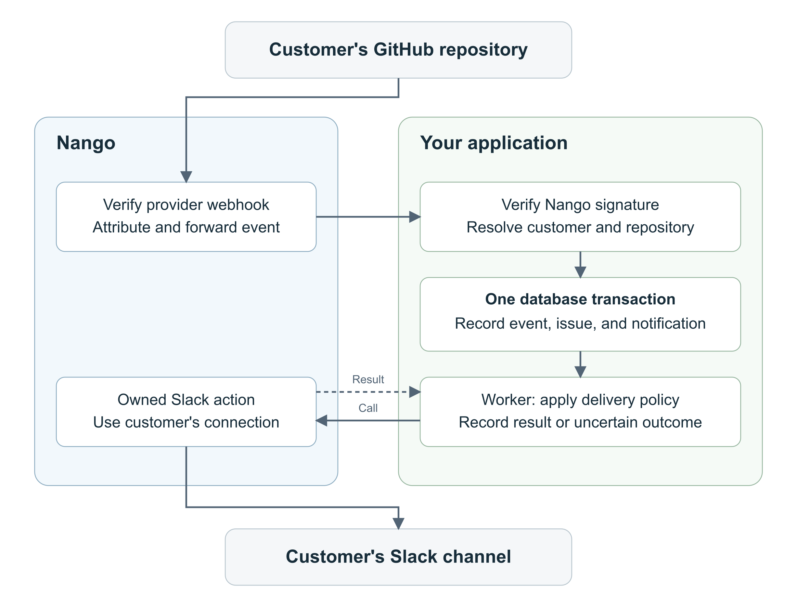

# Migrate a Pipedream workflow to Nango

Author: Emmanuel Oyibo.

A customer's GitHub issue changes, a support application updates its SQLite record, and a worker sends a notification to the customer's connected Slack workspace through Nango. Includes a Pipedream baseline, an owned Nango action, a receiver, a transactional outbox, a read-only dashboard, and tests.

The core flow was tested with connected GitHub and Slack accounts on November 1, 2026, including GitHub redelivery and a controlled cutover/rollback. See [VALIDATION.md](VALIDATION.md) for evidence and limits. The baseline was created for this tutorial; it is not a historical customer workflow or an official Pipedream export.

## Run without accounts

Use Node.js 24.10 or newer:

```bash
npm ci
npm test
NANGO_CLI_UPGRADE_MODE=ignore npm run compile
npm run demo
```

Tests use synthetic fixtures, temporary databases, and local HTTP servers. The demo makes no provider requests. Its report and SQLite database appear in a new ignored `data/demo-*/` directory. Compile type-checks and bundles the Nango action; it does not deploy. The commands disable CLI upgrades and deployment dependency updates to retain the tested versions. Commit the CLI-managed `.nango/` files with the source.

## Architecture



Editable diagram sources: [Mermaid](architecture.mmd) and [SVG](architecture.svg).

| Component | Responsibility |
| --- | --- |
| `pipedream/` | Reproducible source baseline and setup instructions |
| `src/receiver.mjs` | Verify raw-body HMAC, validate the event, resolve the customer route |
| `src/store.mjs` | Atomic delivery deduplication, ordered issue state, outbox, leases, quarantine |
| `src/worker.mjs` | Claim a notification, call the sender, persist the outcome |
| `src/nango-sender.mjs` | Invoke the owned action through the pinned Nango SDK |
| `slack/actions/migration-send-message.ts` | One Slack request with explicit delivery outcomes |
| `src/checkpoint.mjs` | Import an independently verified, already-sent source receipt without resending |
| `src/dashboard.mjs` | Local, read-only view of real database state |

## Configure a live development run

Use a disposable repository with Issues enabled and a channel where test notifications are expected. This example manually seeds one customer's route. It does not implement product enrollment or Connect-session provisioning.

1. Create a GitHub App following [Nango's installation-auth setup](https://nango.dev/docs/api-integrations/github-app/how-to-register-your-own-github-app-api-app). Leave user OAuth during installation unchecked, set Setup URL to `https://api.nango.dev/app-auth/connect`, and enable Redirect on update. Grant Issues read-only; GitHub includes Metadata read-only. For the demo, install only on your test repository.
2. In Nango dev, create a GitHub (App) integration named `github-app`, with your App ID, private key, and public app link. Start its test connection through Nango and complete installation. Create a Slack integration named `slack`, choose a production-supported Nango-managed OAuth app or [configure your own](https://nango.dev/docs/api-integrations/slack/how-to-register-your-own-slack-api-oauth-app), then use **Connections > Add test connection** to authorize the intended workspace. Verify the bot token has `chat:write` and invite the connected bot into the selected channel. The pictured `NangoDevelopersOnlyNotForProduction` bot was used for development only; it is not a production app recommendation.
3. Copy `.env.example` to `.env`. Set `NANGO_API_KEY` and `NANGO_SECRET_KEY_DEV` to your dev Environment API key; set `NANGO_WEBHOOK_SIGNING_KEY` to the separate environment webhook signing key. Keep this file ignored.
4. Copy `fixtures/routes.synthetic.json` to `routes.local.json` and replace all synthetic values with trusted customer, integration, connection, repository, and channel IDs. Copy connection IDs from their Nango connection pages. Copy the Slack channel ID from channel details > **About** > **Channel ID**; get the numeric repository ID from GitHub's repository API. Load the route once:

   ```bash
   npm run routes -- routes.local.json
   ```

   Existing routes cannot be silently reassigned. Never derive the Slack destination or customer identity from arbitrary provider payload fields.
5. Compile and deploy only the owned action:

   ```bash
   NANGO_CLI_UPGRADE_MODE=ignore npm run compile
   NANGO_CLI_UPGRADE_MODE=ignore npx nango deploy dev --integration slack --action migration-send-message --no-dependency-update
   ```

   For a different integration ID, rename the `slack/` source folder and its imports in `index.ts` and `test/action.test.mjs`, then compile. The live validation used a different integration ID with this same action. The public package uses generic IDs.
6. Start the receiver with `npm start`. Expose only `http://127.0.0.1:3407/webhooks/nango` through a trusted HTTPS tunnel. On the GitHub connection's **Settings** tab, edit **Override webhook URL** to the full HTTPS endpoint ending in `/webhooks/nango`, then save. This overrides both shared environment destinations for that connection. Confirm that external webhook forwarding is enabled on the GitHub integration. Copy the GitHub integration's provider webhook URL and secret into the GitHub App; activate Issues events and keep SSL/signature verification enabled.
7. Start the worker separately, or process one event at a time:

   ```bash
   npm run worker -- --once
   npm run inspect
   npm run dashboard
   ```

   The dashboard is at `http://127.0.0.1:3408`. Keep it local. Open, close, and reopen an issue and inspect its record and Slack receipts. A worker/action call makes real provider requests and may send a message.

The receiver accepts at most 1 MiB. It returns 401 for an invalid Nango signature, 503 for a persistence failure, and 202 after quarantining a verified but invalid or unroutable event. Quarantine retains a reason and body hash, not the original payload. Verified irrelevant auth/sync/async callbacks and pings are ignored. Provider verification must remain enabled in Nango. An absent `unverified` flag alone does not establish provider authenticity; this example relies on the configured GitHub App signature checks. Forwarding retries are bounded, so monitor failed deliveries and reconcile missed changes.

Nango derives the GitHub App webhook secret from its configured App ID, private key, and public app link. If you change those values in Nango, copy the new secret into GitHub too. When rotating the separate Nango-to-application signing key, support both old and new keys during the documented five-minute overlap; this single-key demo needs adaptation for that rotation process.

## Customize with a coding agent

The supplied action is ready to compile. If you want to adapt the catalog template yourself, start a separate Nango functions project and use:

```bash
npx skills add NangoHQ/skills -s building-nango-functions-locally
npx nango pull slack send-message --catalog
```

The pull writes the template and dependencies locally. Inspect its input/output schema and retry behavior, then customize and deploy an owned implementation. Do not replace this example's outcome contract with the catalog contract without updating the backend. Follow [coding-agent setup](https://nango.dev/docs/getting-started/coding-agent-setup) for public Docs MCP or authorized Management MCP. The skills/pull commands are documented optional development steps, not extra deployments performed in the live validation.

## Delivery behavior

| Situation | Outcome |
| --- | --- |
| Same delivery ID and snapshot | No new notification |
| Same ID, conflicting snapshot | Quarantine |
| Older unseen event | Preserve newer issue state; notify using that event's snapshot |
| Equal timestamp, conflicting snapshot | Flag the issue for reconciliation |
| Slack success | `sent`, with channel and timestamp |
| Definite Slack HTTP 429 with valid Retry-After | Retry after the delay, at most five total attempts |
| Known auth/permission rejection | `rejected`, retained for operator recovery |
| Timeout, unknown error, malformed response, expired lease | `uncertain`, no automatic resend |

This action has a different output contract from catalog `send-message`. It sets request retries to zero; the worker retries only explicit Slack rate-limit outcomes. Errors from the Nango SDK call, including an unclassified Nango API rate limit, remain uncertain and need reconciliation. A timeout does not cancel remote execution. Reconcile uncertain writes against Nango logs and Slack history before changing any row to pending. Do not run a blanket resend query.

## Import confirmed source state and cut over

Pause the old trigger and drain its executions. Stop the destination worker and reconcile every pending, in-flight, or uncertain write. Verify the source receipt in Slack, then prepare a checkpoint like this using your actual IDs:

```json
{
  "deliveryId": "source-github-delivery-id",
  "action": "closed",
  "issueId": "987654",
  "number": 42,
  "title": "Example support issue",
  "state": "closed",
  "updatedAt": "2026-11-01T10:00:00Z",
  "receipt": { "channel": "C123EXAMPLE", "ts": "1234567890.123456" }
}
```

Keep the checkpoint under ignored `data/`. Supply a route file containing exactly one trusted route:

```bash
node --env-file=.env scripts/import-checkpoint.mjs routes.local.json data/checkpoint.json
```

The importer verifies route/destination consistency and imports state, a delivery record, and a `sent` outbox row in one transaction. It makes no provider calls. It refuses existing delivery IDs, conflicting/older snapshots, and unreconciled outbox work. This command cannot verify that a supplied Slack receipt is genuine; the operator must do that first. It leaves any existing reconciliation flag intact.

This is a single-event checkpoint example, not a general Data Store migration utility. Export all state needed by your product separately. Independent GitHub subscriptions can assign different delivery IDs to the same issue change, so the imported source ID does not prevent duplicates across both subscriptions. Record the switch start time and keep one active notification writer. After enabling the new route, reconcile GitHub changes across the switch interval with an overlapping time window. Update current support records without notifying on historical backfill, and compare source and destination receipts before sending a missing notification. Current issue snapshots cannot reconstruct every intermediate transition; retain durable event history when all transitions matter. This package does not implement that automatic reconciliation/backfill job.

For rollback, stop and drain the new writer before restarting the old trigger. Reconcile state and delivery receipts in the destination system. The live rehearsal exercised a controlled next event on one repository/customer; it did not prove lossless cutover under concurrent traffic.

After testing, disable the demo's provider forwarding/trigger, stop workers and the temporary tunnel, and retain the original configuration for a deliberate restart.

## Scope and limits

SQLite/WAL makes this reproducible on one machine. Integrate the design with your application's database, enrollment, monitoring, retention, and recovery processes before production. The [Node 24.10 documentation](https://nodejs.org/download/release/v24.10.0/docs/api/sqlite.html) marks `node:sqlite` as Stability 1.1 (Active development). The example does not provide exactly-once external writes, automatic backfill, a recovery UI, or a production hosting setup.

See [Nango functions](https://nango.dev/docs/guides/functions/functions-guide), [webhook verification](https://nango.dev/docs/guides/platform/webhooks-from-nango), [forwarding](https://nango.dev/docs/guides/platform/webhook-forwarding), and the [Node SDK](https://nango.dev/docs/reference/backend/backend-sdk/node).
